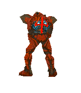

## tristan-renaud

### CHARACTER PROFILE

**Name:** Tristan Renaud  
**Class:** AI/Automation Infrastructure Engineer  
**Work:** RBS Managed IT Services Inc.  
**Origin:** Vancouver Island, Canada  
**Status:** Active

---

### DESCRIPTION

An infrastructure engineer operating out of Vancouver Island, Canada. Specializing in private artificial intelligence systems, Tristan designs and maintains infrastructure that keeps both humans and machines connected.

A self-hosting enthusiast, terminal dweller, and compulsive tinkerer, he prefers understanding the machinery beneath the interface rather than simply using it.

His current pursuits involve building autonomous agents, engineering local AI infrastructure, and eliminating repetitive work through automation.

---

### LOADOUT

**Editor:** Neovim (LazyVim)

**Terminal:** Ghostty

**Multiplexer:** ~~tmux~~ Rex

**Keyboard:** ZSA Voyager

**Computer:** Mac Studio, DGX Spark
